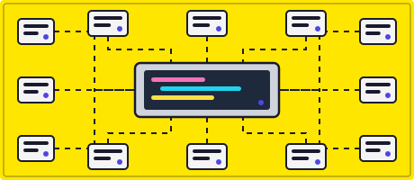

## 👋 About Me

<table>
<tr>
<td width="55%">

<ul>
  <li>🔭 I'm currently a student at <code>SMK Swasta Mandiri</code>.</li>
  <li>🌱 I'm currently learning <code>Web Development</code> in general :D</li>
  <li>📍 From Indonesia 🇮🇩</li>
</ul>

</td>
<td width="45%" align="center">

</td>
</tr>
</table>

## 🧰 Languages and Tools

  

## &lt;/&gt; My Statistics

<table>
<tr>
<td width="50%" align="center">

</td>
<td width="50%" align="center">

</td>
</tr>
</table>
